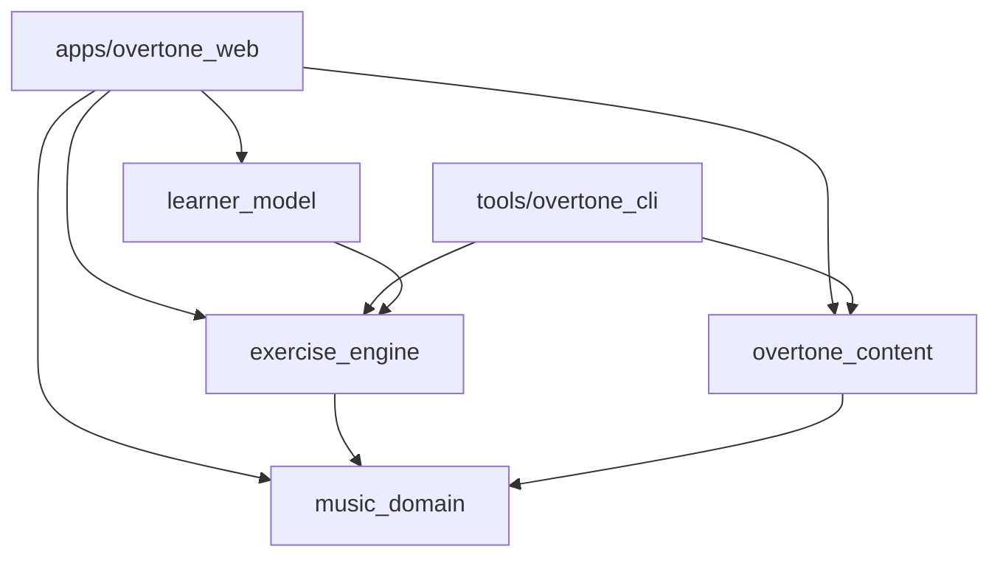

# PLAN.md

Technical architecture for **Overtone** ("More than the notes").

- Product intent and scope: [PROJECT.md](PROJECT.md)
- Ordered work breakdown and acceptance criteria: [MILESTONES.md](MILESTONES.md)

This document records architectural decisions and the reasons for them. Where
a choice depends on a Phase 0 spike, it says so.

------------------------------------------------------------------------

## 1. Toolchain

| Item | Choice |
|---|---|
| Flutter | 3.47.8 stable (installed) |
| Dart | 3.13.7 (installed). Dart workspaces (pub workspaces) are available |
| Web renderer | Flutter's default web renderer (CanvasKit/Skwasm); verify in spike S1 |
| State management | Riverpod |
| Routing | `go_router`, hash URL strategy |
| Local storage | `sembast_web` (IndexedDB) behind a storage interface; confirm in spike S6 |
| Notation | OpenSheetMusicDisplay (OSMD), bundled locally, via `dart:js_interop` |
| Audio | Custom Web Audio engine via `dart:js_interop` |
| Content tooling | Dart CLI (`overtone`) |
| CI/CD | GitHub Actions to a `gh-pages` branch |

Package versions are not pinned here. Pin them when the packages are added,
and review each license (PROJECT.md section 14).

------------------------------------------------------------------------

## 2. Repository layout

Single repository, Dart workspace, content kept separable.

```text
overtone/
  pubspec.yaml                  workspace root (lists members)
  README.md
  LICENSE                       GPL-3.0 (code)
  CONTRIBUTING.md               states CC BY-SA for content contributions

  apps/
    overtone_web/               Flutter web app
      lib/
      web/                      index.html, js/ (audio engine, OSMD bundle)
      test/
      integration_test/

  packages/
    music_domain/               pure Dart: pitch, interval, chord, key, rhythm
    overtone_content/           pure Dart: frontmatter, schemas, links, index builder
    exercise_engine/            pure Dart: exercise types, generation, evaluation
    learner_model/              pure Dart: attempts, mastery, recommendations

  tools/
    overtone_cli/               `overtone` command (validate, build, new)

  content/                      Obsidian vault (see section 4)
    overtone.yaml
    _templates/
    ...

  .github/workflows/
    ci.yaml
    deploy-app.yaml
    deploy-content.yaml

  docs/                         ADRs and developer notes
```

`content/` has no dependency on the code. It can move to its own repository
later by changing the content workflow and the configured content root.

### 2.1 Package dependency rules



- `music_domain`, `overtone_content`, `exercise_engine`, and `learner_model`
  contain no Flutter or browser imports, so the CLI and plain `dart test`
  can use them.
- Browser-specific code (audio, OSMD, IndexedDB, file download) lives only in
  `apps/overtone_web`, behind interfaces defined in the pure packages.
- No package imports the app. No package imports a sibling that is above it
  in the diagram.

------------------------------------------------------------------------

## 3. Layered runtime architecture

```text
apps/overtone_web
  presentation   screens, widgets, markdown renderer, block widgets
  application    Riverpod providers and controllers (session, playback, progress)
  platform       web adapters: AudioEngine (JS), NotationView (OSMD), Storage (sembast), FileIO
------------------------------------------------------------------------
packages         pure Dart domain, content, exercises, learner logic
```

Rules:

1. Widgets never contain musical facts or exercise rules. They call into
   packages through providers.
2. Platform adapters implement interfaces from the packages
   (`SoundSource`, `AttemptStore`, `ContentSource`). Tests substitute fakes.
3. Providers expose immutable state. Controllers hold session state.

------------------------------------------------------------------------

## 4. Content system

### 4.1 Vault rules (from PROJECT.md section 5)

- Notes are Markdown with YAML frontmatter. `type` identifies the note kind.
- Filename (without `.md`) equals `id`. IDs are unique across the vault.
- Hierarchy comes from folders. Each subject, category, and topic folder
  contains exactly one folder note of that type.
- Wikilinks are `[[id]]` or `[[id|label]]`. Embeds are `![[file]]`.
- Source-only files (`.mscz`, `.obsidian/`, `_templates/`) are never
  published.

### 4.2 Vault configuration

`content/overtone.yaml`:

```yaml
schemaVersion: 1
contentVersion: 0.1.0
title: Overtone Content
```

`schemaVersion` is the contract between the content and the app.
`contentVersion` is editorial. The CLI copies both into `manifest.json`.

### 4.3 Note types and required frontmatter

| `type` | Location | Required | Optional |
|---|---|---|---|
| `subject` | folder note | `id`, `title` | `description`, `order`, `icon` |
| `category` | folder note | `id`, `title` | `description`, `order` |
| `topic` | folder note | `id`, `title` | `description`, `order`, `skills` |
| `lesson` | in a topic folder | `id`, `title`, `difficulty` | `description`, `estimatedMinutes`, `objectives`, `prerequisites`, `exercises`, `flashcards`, `skills`, `tags`, `order` |
| `exercise-set` | in a topic folder | `id`, `title`, `exerciseType`, `settings`, `skills` | `difficulty`, `questionCount`, `feedback`, `tags` |
| `flashcard-set` | in a topic folder | `id`, `title`, `cards`, `skills` | `difficulty`, `tags` |
| `skill` | `skills/` | `id`, `title` | `parentSkill`, `relatedTopics` |
| `reference` | `reference/` | `id`, `title`, `kind`, `entries` | none |
| `instrument` | `instruments/` | `id`, `title`, `kind` (`keyboard` or `fretted`), `layout` | `tunings` |

Notes:

- `subject`, `category`, and `topic` on a lesson or set are derived from its
  folder. If declared, they must match.
- `reference.kind` values for the MVP: `interval-types`, `chord-types`,
  `scale-types`, `glossary`, `exercise-presets`.
- `exerciseType` must be registered in `exercise_engine`. `settings` is
  validated by that exercise type's own parser (section 7).
- Flashcard card shape: `front`, `back`, optional `skills`, optional `media`.

### 4.4 Markdown body features

Supported in v1: headings, paragraphs, emphasis, lists, tables, block quotes,
links, wikilinks, callouts, inline code, embeds, and musical blocks.

Embeds:

| Extension | Result |
|---|---|
| `.svg`, `.png`, `.jpg`, `.webp` | inline image (alt text or caption required) |
| `.mp3` | audio player (caption required) |
| `.musicxml` | not embedded directly; use a `notation` block |

Musical blocks are fenced code blocks with a YAML body:

| Language tag | Required keys | Notes |
|---|---|---|
| `notation` | `source` | optional `display`, `playback`, `highlight` |
| `chord` | `root`, `quality` | optional `display` (`keyboard`, `fretboard`, `staff`), `inversion` |
| `fretboard` | `instrument` | optional `tuning`, `chord`, `scale`, `highlight` |
| `keyboard` | none | optional `range`, `highlight` |

Block specs (keys, types, allowed values) are defined once in
`overtone_content` as `BlockSpec` objects. The CLI validator and the app
renderer use the same specs, so what validates is what renders. Unknown
block tags render as a visible warning in development and are hidden in
production.

### 4.5 Build pipeline

`overtone content build --out dist/content`:

1. Scan the vault; ignore `_templates/`, `.obsidian/`, and non-allowlisted
   extensions.
2. Parse frontmatter. Validate against the schema for each `type`.
3. Check filename/ID match and ID uniqueness.
4. Derive hierarchy from folders. Check folder-note rules and any declared
   hierarchy fields.
5. Parse bodies. Extract wikilinks, embeds, and blocks. Resolve each to an
   ID or file. Validate block specs.
6. Cross-check references: prerequisites, exercises, flashcards, skills,
   related topics, `exerciseType`, and each exercise set's settings.
7. Check assets: every embed and `source` exists and is allowlisted.
8. Write output:

```text
dist/content/
  manifest.json
  index/
    nodes.json        all note metadata (no bodies), keyed by id
    graph.json        hierarchy, prerequisites, links, backlinks
    search.json       title, tags, headings, skills per id
    media.json        filename -> published path
  <copied notes and media, same relative paths>
```

`manifest.json` lists schema version, content version, build time, and a
content hash for every published file. The app requests each file with
`?v=<hash>`, so browsers and GitHub Pages' 10-minute cache cannot serve stale
content, and unchanged files are reused.

Raw `.md` files are published as authored. The app strips frontmatter with the
same parser from `overtone_content`.

### 4.6 CLI commands

| Command | Behavior |
|---|---|
| `overtone content validate [--strict]` | Report problems; non-zero exit on errors. `--strict` also fails on warnings |
| `overtone content build --out <dir>` | Validate, then generate output |
| `overtone content new <type> <id>` | Scaffold a note in the folder given by `--in` or the current folder |
| `overtone content graph` | Print orphan notes, unreachable lessons, and prerequisite cycles |

Diagnostics format: `path:line:column severity code message`, with a
suggestion line where possible (for example, `did you mean 'interval-recognition'?`).
Severity is `error` or `warning`. Codes are stable strings (`E-ID-DUP`,
`E-SKILL-UNKNOWN`, and so on) listed in `docs/diagnostics.md`.

### 4.7 Runtime loading

- `ContentSource` interface with an HTTP implementation. The root URL comes
  from `--dart-define=CONTENT_ROOT` and defaults to `content/` relative to
  the page's base URI.
- Startup loads `manifest.json` (cache-busted by timestamp), then
  `index/nodes.json` and `index/graph.json`. Search index and note bodies
  load on demand.
- `schemaVersion` outside the range the app supports shows a "content needs a
  newer app" message. An unreadable note shows an error for that item only;
  other content continues to load.

------------------------------------------------------------------------

## 5. Music domain (`music_domain`)

Pure Dart. No I/O. Immutable value types with `==` and `hashCode`.

### 5.1 Core types

| Type | Representation |
|---|---|
| `Letter` | enum A to G |
| `Accidental` | integer in -2..2 (double flat to double sharp) |
| `PitchClass` | letter + accidental |
| `Pitch` | letter + accidental + octave. `midi` is derived. Enharmonics compare equal by `midi` through `isEnharmonicTo`, not `==` |
| `Interval` | diatonic number (1-based, compound allowed) + quality + direction. Semitones derived |
| `IntervalQuality` | diminished, minor, perfect, major, augmented, plus multiples |
| `ChordType` | name, symbol, interval formula (from content reference data) |
| `Chord` | root `PitchClass` + `ChordType` + optional inversion |
| `Voicing` | ordered list of `Pitch` for a chord |
| `Key` | tonic + mode |
| `Duration` | rational: `numerator / denominator` of a whole note; ticks at a fixed resolution (960 per quarter) derived |
| `TimeSignature`, `Tempo` | integers; tempo in quarter-notes per minute |
| `PlaybackEvent` | onset (ticks), duration (ticks), MIDI pitch, velocity, voice tag |

### 5.2 Rules

- Spelling is preserved everywhere; MIDI is derived, never the source.
- Interval arithmetic (pitch + interval, interval between pitches, inversion)
  is algorithmic from diatonic step and semitone counts. It does not read
  content data.
- Names, symbols, and formulas for chord types and interval types come from
  `reference` notes, loaded into registries (`ChordTypeRegistry`,
  `IntervalTypeRegistry`). Tests load fixtures that mirror the content files.
- Time uses integers or rationals only. No floating-point beats.
- Equal temperament only for MVP: frequency = 440 * 2^((midi - 69) / 12).

### 5.3 MVP scope

Pitch, interval, triad chords, inversions, major and natural-minor keys,
durations, playback event generation. Seventh chords, extensions, modes,
Roman numerals, and voice leading come after the MVP.

------------------------------------------------------------------------

## 6. Rendering

### 6.1 Markdown renderer

- Parse with `package:markdown` into an AST with custom syntaxes for
  wikilinks, embeds, and fenced musical blocks. Callouts are detected from
  block quotes that start with `> [!type]`.
- Render the AST with an in-repo `NodeRenderer` that maps node types to
  widgets. Reason: the Flutter markdown widget packages have had maintenance
  changes, and custom blocks plus accessibility need control. Confirm in
  spike S2 before committing.
- Raw HTML is never rendered. It is shown as plain text.
- Block widgets are registered in a `BlockRegistry` keyed by language tag,
  sharing the `BlockSpec` definitions from `overtone_content`.
- Internal links navigate with `go_router`; external links open in a new tab
  with `rel="noopener noreferrer"` semantics.

### 6.2 Notation (OSMD)

- OSMD is vendored into `apps/overtone_web/web/js/` as a built bundle, with
  its license file. No CDN.
- Flutter integration: an `HtmlElementView` hosts a `div`. A thin JS module
  `overtone_notation.js` wraps OSMD and exposes:
  `load(containerId, musicXmlString, options)`, `highlight(measure, beat)`,
  `clear()`, and a click callback that reports the clicked note's measure and
  index to Dart.
- Dart side: `NotationView` widget plus a `NotationController` interface
  (`load`, `highlight`, `onNoteTapped`).
- Display-only is the MVP. The controller API reserves selection and
  highlight so interaction can come later without changing callers.
- Fallback if spike S3 fails: Verovio (WASM, SVG) behind the same
  `NotationController` interface.

### 6.3 Keyboard and fretboard

- Drawn natively with `CustomPainter`, driven by `instrument` notes
  (layout, tunings) and domain `Pitch` lists. No JS involved.
- Both accept a highlight set and a tap callback so they can be reused for
  Apply exercises.
- Piano range and guitar tuning/fret count come from instrument data.

### 6.4 Accessibility

- Every interactive widget has a semantic label.
- Notation and diagrams have a text alternative derived from the block
  (for example, "C major triad: C, E, G").
- Audio-only exercises offer a text description of the task and a note
  that a visual alternative is not always available.
- Feedback never relies on color alone.
- Full keyboard navigation for lessons and practice (tab order, Enter/Space
  to answer, `R` to replay).

------------------------------------------------------------------------

## 7. Exercise engine (`exercise_engine`)

### 7.1 Interface

```dart
abstract class ExerciseType<S, Q, R> {
  String get id;                                    // e.g. 'identify-interval'
  S parseSettings(Map<String, Object?> raw, Diagnostics d);
  Q generate(S settings, Random rng, DomainContext ctx);
  PromptSpec prompt(Q question);                    // what to present: events, notation, text
  AnswerSpec answerSpec(Q question);                // choices or input kind
  Evaluation evaluate(Q question, R response);
  List<SkillEvidence> evidence(Q q, Evaluation e, AttemptContext a);
}
```

- `parseSettings` runs in the CLI (to validate content) and in the app (to
  load it). Same code, same result.
- `prompt` and `answerSpec` describe the question as data. The app maps
  `PromptSpec` kinds (audio, notation, text, keyboard, fretboard) to widgets.
- `Random` is injected so tests are deterministic. Sessions store the seed.
- A `DomainContext` provides registries (chord types, interval types) loaded
  from content.

### 7.2 Registry

`ExerciseRegistry` maps `exerciseType` strings to implementations. Adding a
type means adding a class and registering it; content then uses it with no
other change.

### 7.3 MVP exercise types

| Id | Prompt | Response |
|---|---|---|
| `identify-interval` | audio (harmonic or melodic) | choice |
| `identify-triad-quality` | audio | choice |
| `identify-note-on-staff` | notation | choice |
| `construct-triad` | text (root + quality) | selected pitch set on keyboard or staff |
| `compare-interval-presentation` | audio pair | choice |

Progression and rhythm exercises follow in later milestones.

### 7.4 Session

`ExerciseSession` is a pure state machine:
`idle -> asking -> answered -> (asking | finished)`. It records each
`AttemptRecord` (question id, seed, response, correctness, response time,
replay count, hints) and returns `SkillEvidence` items.
The application layer persists attempts; the session itself does no I/O.

### 7.5 Presets

`reference` notes of kind `exercise-presets` define named difficulty levels
(for example, `beginner` = interval set, directions, question count). An
exercise set can name a preset and override individual settings.

------------------------------------------------------------------------

## 8. Audio

### 8.1 Separation

```text
PlaybackEvent[] (domain)  -->  Scheduler  -->  SoundSource  -->  speakers
        musical request      tempo mapping     Web Audio synth
```

`SoundSource` is a Dart interface:

```dart
abstract class SoundSource {
  Future<void> unlock();                       // resume AudioContext on user gesture
  double get now;                              // context time, seconds
  PlaybackHandle play(List<ScheduledNote> notes, {double startAt});
  void stopAll();
}
```

A future sample-based source implements the same interface.

### 8.2 Web implementation

- `web/js/overtone_audio.js` (ES module, no dependencies):
  - owns one `AudioContext`, created or resumed on the first user gesture;
  - master gain into a `DynamicsCompressor` used as a limiter, to prevent
    clipping;
  - `playNotes(batch)` schedules oscillator voices at absolute context
    times, each with an ADSR gain envelope;
  - each `play` call returns a handle; `stop(handle)` ramps the group gain
    down over a few milliseconds and disconnects it, so a new question can
    replace playback cleanly with no clicks;
  - exposes `currentTime()` for the Dart side.
- Dart wrapper uses `dart:js_interop` and `package:web`. It converts ticks to
  seconds using the tempo and sends one batch per `play`.
- Timing: exercise examples are short, so the whole sequence is scheduled
  at once on the audio clock. Dart timers are never used for note timing.
  Long or looping playback, if added later, uses a lookahead scheduler on top
  of the same batch call.

### 8.3 MVP voice

One oscillator-based "keys" voice: a few sine/triangle partials with a fast
attack and exponential decay. It must be clearly pitched and unfatiguing at
beginner exercise lengths. Guitar-like and richer timbres, and sampled
instruments, are later work behind the same interface.

### 8.4 Autoplay and gestures

- No audio before a user gesture. The first Play, Start, or answer tap calls
  `unlock()`.
- The UI shows a clear "tap to enable sound" state when the context is
  suspended.
- A visible volume control and mute control are always available during
  practice.

------------------------------------------------------------------------

## 9. Learner model (`learner_model`)

### 9.1 Data

| Record | Fields |
|---|---|
| `AttemptRecord` | id, timestamp, exerciseSetId, questionId, seed, skillIds, correct, responseMs, replays, hints, difficulty, settingsHash |
| `LessonProgress` | lessonId, status (`seen`, `completed`), lastVisited |
| `SkillEstimate` | skillId, score 0..1, evidenceCount, distinctVariants, lastPracticed. Derived; never imported |
| `Preferences` | theme, text scale, audio volume, reminder timestamps |
| `Meta` | learnerId (random UUID, local), schemaVersion, createdAt, lastExportedAt |

No personal information is collected. The learner ID is random and local.

### 9.2 Storage

- `AttemptStore` interface in `learner_model` (append attempt, query by skill
  and time range, read and write progress and preferences, wipe).
- `sembast_web` implementation in the app, with these stores: `attempts`,
  `lessonProgress`, `preferences`, `meta`.
- Writes are append-only for attempts. Skill estimates are recomputed from
  attempts on demand and cached in memory, so changing the estimator never
  needs a data migration.
- Storage schema version is kept in `meta`. Migrations run in order on
  startup and are covered by tests with stored fixtures.

### 9.3 Export and import

Single JSON file:

```json
{
  "format": "overtone-progress",
  "formatVersion": 1,
  "exportedAt": "2026-01-01T00:00:00Z",
  "appVersion": "0.1.0",
  "contentVersion": "0.1.0",
  "learnerId": "...",
  "preferences": {},
  "lessonProgress": [],
  "attempts": []
}
```

- Export triggers a browser download. Import reads a user-chosen file.
- Import validates `format` and `formatVersion`, migrates older versions, and
  asks whether to replace or merge. Merge de-duplicates attempts by id.
- Unknown skill or exercise IDs in imported data are kept but flagged
  inactive, so progress is not lost if content is renamed or removed.
- Reminders: after N attempts or D days since `lastExportedAt` (initial
  values to be tuned), show a dismissible banner. Never shown during
  practice.
- "Erase all progress" in Settings wipes IndexedDB after confirmation.
- Browsers can evict storage. The app requests persistent storage
  (`navigator.storage.persist()`) where available and says plainly that
  export is the safe backup.

### 9.4 Mastery estimate (initial, transparent)

For each skill:

- weight each attempt by difficulty and by recency (exponential decay with a
  configurable half-life);
- score = weighted accuracy;
- a skill is `established` only with at least M attempts across at least V
  distinct question variants (initial tunables: M = 20, V = 3);
- below that, status is `learning` and the score is shown as provisional;
- replays and hints reduce the weight of a correct answer.

The numbers are defaults in one config object and are expected to change.

### 9.5 Recommendations

Rule-based and explainable. Each recommendation is
`{kind, targetId, reason}` where `reason` is a human-readable sentence.

1. Weakest skill with enough evidence: suggest an exercise set and a related
   lesson that list that skill.
2. Skill not practiced within a review window: suggest a short review.
3. No history: suggest starting points based on the level the learner
   selected at first run.
4. Prerequisites: do not recommend a lesson whose prerequisites are
   unseen, unless the learner asks for it.

Recommendations are dismissible, and dismissed items are not repeated for a
period.

------------------------------------------------------------------------

## 10. Application shell

### 10.1 Routes (hash URLs)

| Route | Screen |
|---|---|
| `/` | Home (continue, suggestions, quick practice) |
| `/learn` | Subject browser |
| `/learn/:subject/...` | Category and topic pages (path comes from the index) |
| `/lesson/:id` | Lesson view |
| `/train` | Practice launcher |
| `/train/:exerciseSetId` | Exercise session |
| `/flashcards/:id` | Flashcard session |
| `/explore` | Search and related-concept browsing |
| `/progress` | Skills and history |
| `/settings` | Preferences, export/import, erase data |
| `/about` | Licenses, attributions, Patreon link |

The hash strategy is the default in Flutter web, which keeps refresh and direct
links working on GitHub Pages without redirect workarounds.

### 10.2 Providers (Riverpod)

- `contentSourceProvider`, `manifestProvider`, `nodesProvider`,
  `graphProvider`, `noteBodyProvider(id)`.
- `audioProvider` (SoundSource), `notationControllerFactoryProvider`.
- `storageProvider` (AttemptStore), `progressProvider`,
  `skillEstimatesProvider`, `recommendationsProvider`.
- `sessionControllerProvider(exerciseSetId)`.

### 10.3 Search

Client-side. The CLI emits `search.json` (title, tags, headings, skills per
note). The app builds a small in-memory index on first use of `/explore`.
Revisit only if the index becomes too large.

### 10.4 Support and ads

- The Patreon link appears in the footer and `/about`. It never appears
  during practice.
- No advertising code ships in version 1.

------------------------------------------------------------------------

## 11. Build, deployment, and CI

### 11.1 GitHub Pages model

The site is served from the `gh-pages` branch at
`https://johnnygizmo.github.io/Overtone/`:

```text
gh-pages/
  index.html, main.dart.js, assets/, ...    published by deploy-app
  content/                                    published by deploy-content
```

GitHub Pages hosts one artifact, so two independent workflows cannot each
deploy a full Pages artifact without overwriting the other. Both therefore
publish to the `gh-pages` branch, each limited to its own path (the app
workflow keeps `content/`, the content workflow touches only `content/`).
Both share a `concurrency` group so they never write at the same time.
Pages is configured to deploy from the branch.

### 11.2 Workflows

| Workflow | Trigger | Steps |
|---|---|---|
| `ci.yaml` | pull request | `dart pub get`; `dart analyze`; `dart format --set-exit-if-changed`; unit tests for each package; `overtone content validate --strict`; `flutter build web` smoke build |
| `deploy-app.yaml` | push to `main` touching `apps/**` or `packages/**` | test; `flutter build web --release --base-href /Overtone/`; publish to `gh-pages` root, keeping `content/` |
| `deploy-content.yaml` | push to `main` touching `content/**` | `overtone content build --out dist/content`; publish to `gh-pages` `content/` only |

A content-only change never triggers a Flutter build.

### 11.3 Base path and content root

- `--base-href /Overtone/` is set at build time. A custom domain later
  changes only this flag.
- The content root defaults to `content/` resolved against the document's
  base URI, so the same build works under any base path. It can be
  overridden with `--dart-define=CONTENT_ROOT=...`, which is how the content
  moves to another repository or host later.

### 11.4 Caching

- App files: Flutter's service worker handles app caching; verify that
  updates are picked up (spike S5). Decide whether to disable the service
  worker if it causes stale builds.
- Content: manifest fetched with a timestamp query. Every other content file
  is fetched with `?v=<hash>` from the manifest.

### 11.5 Security headers

GitHub Pages does not allow custom response headers. Use a `<meta>` CSP in
`index.html` as far as Flutter's requirements allow, and record the limits in
`docs/`. Validate in spike S5.

------------------------------------------------------------------------

## 12. Testing

| Level | Scope | Tooling |
|---|---|---|
| Unit | `music_domain` (spelling, intervals, inversion, chord construction, durations) | `dart test`, property-style tests for interval arithmetic |
| Unit | `overtone_content` (frontmatter, links, embeds, blocks, hierarchy rules, hashing) | `dart test` with fixture vaults, including invalid ones with expected diagnostic codes |
| Unit | `exercise_engine` (generation bounds, deterministic seeds, evaluation, evidence) | `dart test` |
| Unit | `learner_model` (estimator, recommendations, migrations, import/export) | `dart test` with fixtures |
| Widget | block widgets, markdown renderer, practice screens | `flutter test`, golden tests for keyboard and fretboard |
| Integration | load content, open lesson, run a session, persist, export/import | `integration_test` on Chrome |
| Manual | audio timing and feel, notation fidelity, phone layouts, accessibility | checklist in `docs/` |

Notes:

- A **fixture vault** in the CLI package tests is the canonical sample
  content for all packages.
- Manual device checks cover Android Chrome and desktop Chrome, Firefox, and
  Edge. Safari and iOS are out of scope for v1.
- Sample MusicXML files are checked into the renderer spike for comparison.

------------------------------------------------------------------------

## 13. Security and privacy

- Content is data. Nothing in Markdown or frontmatter is evaluated.
- No raw HTML from Markdown reaches the DOM. SVG is rendered through a
  Flutter SVG widget, not injected into the page.
- All content paths are normalized and must stay inside the content root
  (CLI and runtime both enforce this).
- OSMD receives MusicXML as data only. Notation JS is bundled and reviewed.
- No keys, tokens, or secrets in the client or repository.
- No analytics in v1 (decision still open in PROJECT.md section 18; add only
  with a privacy-preserving, aggregate-only tool).
- Progress never leaves the browser except by user-initiated export.
- Every bundled third-party asset is recorded in `docs/third-party.md` with
  its source, license, and attribution text; the About page renders from it.

------------------------------------------------------------------------

## 14. Phase 0 spikes

Each spike has a question, a throwaway prototype, and a short written
decision in `docs/adr/`.

| Id | Question | Pass criteria |
|---|---|---|
| S1 | Does a Flutter web build load, route, and refresh correctly from GitHub Pages under `/Overtone/`? | Deep link and refresh work; `--base-href` correct; fonts and assets load |
| S2 | Can `package:markdown` with custom syntaxes plus an in-repo renderer cover section 4.4? | Wikilinks, callouts, embeds, and all four block kinds render from a sample note |
| S3 | Does OSMD render the sample MusicXML set acceptably, bundled locally, in `HtmlElementView`, and report note clicks? | Treble/bass, key/time signatures, chords, ties render; click returns measure and index; resize works. Otherwise evaluate Verovio |
| S4 | Is the custom Web Audio engine accurate and click-free on desktop and phone Chrome? | Intervals and triads schedule on the audio clock; `stop` and replace are clean; no clipping at full volume; gesture unlock works |
| S5 | Do app and content updates reach returning users under the service worker and Pages caching? Does a meta CSP work with Flutter web? | A content-only publish is visible after reload; an app publish is picked up; CSP does not break the app, or limits are documented |
| S6 | Is `sembast_web` adequate for append-heavy attempt storage and large export? | 50k synthetic attempts: write, query by skill, export, import within acceptable time and size |
| S7 | Do frontmatter parsing, wikilink/embed/block extraction, and hashing in `overtone_content` behave identically in the CLI and in the web app? | Same fixtures pass under `dart test` and `flutter test --platform chrome` |

------------------------------------------------------------------------

## 15. Risks

| Risk | Mitigation |
|---|---|
| OSMD fidelity or interaction is insufficient | Spike S3; Verovio fallback behind `NotationController` |
| Web audio timing differs by browser | Spike S4; schedule on the audio clock; document unsupported browsers |
| Two workflows publishing to one Pages site race or overwrite | Branch deployment with path-scoped publishing and a shared concurrency group; verify in S1 |
| Service worker serves stale app builds | Spike S5; consider disabling the service worker |
| Content schema drift breaks old content | `schemaVersion`, strict validation in CI, fixtures for every note type |
| Obsidian "full compatibility" expands scope | Supported syntax is the list in section 4.4; the validator warns on anything else |
| Browser storage cleared or evicted | Persistent-storage request, export reminders, clear wording about backups |
| Flutter markdown packages change or lapse | In-repo renderer over `package:markdown` |
| Third-party license conflicts (OSMD, fonts, sounds) | Audit before bundling; track in `docs/third-party.md` |
| Safari/iOS users arrive anyway | Detect unsupported browsers and show a clear notice instead of a broken app |

------------------------------------------------------------------------

## 16. Open items to resolve during implementation

- Exact GitHub user or organization and repository name (affects
  `--base-href`).
- License is GPL-3.0 for code (decided); content is CC BY-SA. Verify that
  every bundled third-party library (for example OSMD) is GPL-3.0
  compatible.
- Whether the app should offer an "advanced" display mode for note names
  later (out of scope, English only for v1).
- Math rendering format (deferred; not needed for the MVP content).
- Analytics: none for v1.
- Initial values for mastery tunables and export reminder thresholds.
